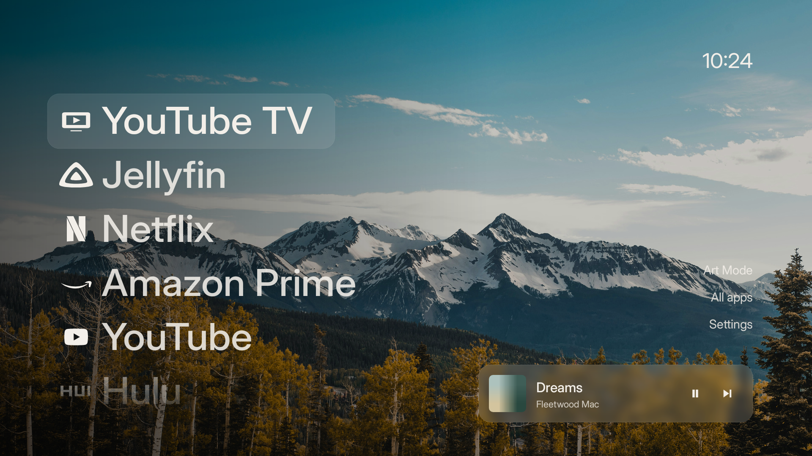

<p align="center">
  
</p>

<p align="center">A quiet home screen for Android TV.</p>

<p align="center">
  <a href="https://kotlinlang.org"></a>
  <a href="https://developer.android.com/tv"></a>
  <a href="https://developer.android.com/develop/ui/views/layout/declaring-layout"></a>
  <a href="https://gradle.org"></a>
</p>

<p align="center">
  
</p>

Palmyra puts your apps in front of a mountain view. Built for a remote, with a
small native Kotlin core and no ads, recommendations or network requests.

- **Your favorites, up front.** A simple app list, plus All apps and system Settings.
- **A little more scenery.** Fifteen bundled wallpapers, slow crossfades and Art Mode.
- **Music within reach.** An optional glass Spotify player with album art and playback controls.
- **Small by design.** Plain Android views. Kotlin stdlib is the only runtime dependency.

## Build

Requires JDK 17 and Android SDK 36. The Gradle wrapper is included.

```sh
source scripts/env.sh
./gradlew assembleRelease
scripts/verify
```

The APK is written to `app/build/outputs/apk/release/app-release.apk`.
Without a private signing configuration, local builds use the Android debug key.
See [development](docs/development.md) for setup, tests and customization.

## Use

Install the APK with ADB, then choose Palmyra as your Home app in Android settings.

```sh
adb -s DEVICE_SERIAL install -r app/build/outputs/apk/release/app-release.apk
```

Use the D-pad to move, Select to open an app, and Right to reach the menu.
Art Mode hides the interface; Left and Right change the photo.

For the Spotify player, enable notification access for **Palmyra Spotify playback**
in Android settings. It reads Spotify's media session while Home is visible.
No Spotify login, API connection or polling. [Usage details](docs/usage.md).

---

Photography, icons and typeface: [asset credits](CREDITS.md).
